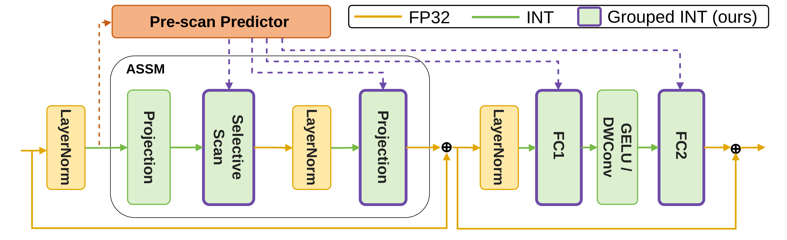

# TGQ-MambaSR: Hardware-Friendly Token-Group Activation Quantization for Low-Bit Mamba Super-Resolution

**NeurIPS 2026** · [Paper (PDF)](https://arxiv.org/pdf/2610.16261) · [arXiv](https://arxiv.org/abs/2610.16261) · [Poster page](https://neurips.cc/virtual/2026/loc/paris/poster/155635)

Jinwoo Chung, Jangho Kim\* · Kookmin University (\*corresponding author)

Official PyTorch implementation of **Token-Group Quantization (TGQ)**, a post-training quantization
(PTQ) method for low-bit (W4A4 / W2A2) **Mamba-based image super-resolution** (MambaIRv2, MambaIR).
A frozen pre-scan predictor assigns each token to a group and looks up offline-calibrated, group-wise
clipping bounds, so inference stays static. Clipping bounds are refined with a
**Frequency-Preserving Refinement (FPR)** loss. See the paper for details.

<p align="center"></p>

**Keywords:** post-training quantization · PTQ · low-bit quantization · activation quantization ·
token-group quantization · Mamba · state space model (SSM) · selective scan · MambaIR · MambaIRv2 ·
image super-resolution (SISR) · image restoration · JPEG artifact removal · image denoising ·
SwinIR · W4A4 · W2A2 · 4-bit · 2-bit · model compression · efficient inference · edge deployment ·
Jetson Orin Nano · NeurIPS 2026

## Contents

| Path | What it is |
|---|---|
| `calibrate.py` / `infer.py` | SR calibration and evaluation (MambaIRv2-Light / -Base, SwinIR-light; `--protocol freeze` or `lora`) |
| `calibrate_ir.py` / `infer_ir.py` | JPEG artifact removal and color denoising on MambaIRv2-Base |
| `tgq/` | Token-group quantization: predictor, group-wise quantizers, FPR loss, pipeline |
| `quant/` | Fake quantizers, MSE bound search, quantized layers, LoRA rectifier group |
| `arch/`, `data/`, `scripts/` | Backbones, loaders, reproduction scripts |

## Installation

```bash
git clone https://github.com/imaboybut/TGQ-MambaSR.git && cd TGQ-MambaSR
pip install -r requirements.txt        # torch>=2.0, numpy, einops, Pillow, scikit-learn
```

`mamba_ssm` is optional; without it a pure-PyTorch parallel scan is used.

## Data and full-precision weights

Nothing is downloaded automatically. Place the files as follows (or set the `--*-root` flags).

```
pretrained/
├── mambairv2_lightSR_x{2,4}.pth                       # MambaIRv2 release
├── mambairv2_classicSR_Base_x{2,4}.pth                # optional, --model base
├── mambairv2_jpeg_q{10,30,40}.pth, mambairv2_ColorDN_15.pth   # optional, IR tasks
└── 002_lightweightSR_DIV2K_s64w8_SwinIR-S_x{2,4}.pth  # optional, --backbone swinir
datasets/
├── DF2K/DF2K_train_HR/*.png
├── DF2K/DF2K_train_LR_bicubic/X{2,4}/{stem}x{scale}.png
├── benchmark/{Set5,Set14,B100,Urban100,Manga109}/{HR,LR_bicubic/X{2,4}}/
├── DIV2K/DIV2K_valid_HR/*.png                         # optional, IR calibration
└── benchmark_ir/CAR/{classic5,LIVE1}/, benchmark_ir/ColorDN/{CBSD68HQ,Kodak24HQ,McMasterHQ,Urban100HQ}/
```

Weights: [MambaIR / MambaIRv2](https://github.com/csguoh/MambaIR), [SwinIR](https://github.com/JingyunLiang/SwinIR).

## Usage

```bash
# MambaIRv2-Light, x2, W4A4 (use --bit 2 for W2A2, --scale 4 for x4)
python data/make_calib_set.py --scale 2
python calibrate.py --scale 2 --bit 4 --save ckpts/mambairv2_light_x2_w4a4.pth
python infer.py --ckpt ckpts/mambairv2_light_x2_w4a4.pth

# Weight-training PTQ with LoRA rectifier groups
python calibrate.py --scale 2 --bit 4 --protocol lora --save ckpts/mambairv2_light_x2_w4a4_lora.pth

# MambaIRv2-Base, SwinIR-light
python calibrate.py --model base --scale 2 --bit 4 --tile 128 --save ckpts/mambairv2_base_x2_w4a4.pth
python calibrate.py --backbone swinir --scale 2 --bit 4 --save ckpts/swinir_light_x2_w4a4.pth

# JPEG artifact removal / color denoising
python data/make_ir_calib_sets.py --hr-dir datasets/DIV2K/DIV2K_valid_HR
python calibrate_ir.py --task CAR-q10 --bit 4 --save ckpts/mambairv2_base_car_q10_w4a4.pth
python infer_ir.py --ckpt ckpts/mambairv2_base_car_q10_w4a4.pth
```

Multi-GPU: `torchrun --standalone --nproc_per_node=N calibrate.py ...`. Full sweeps are in `scripts/`.
The MambaIRv2 forward pass is stochastic (Gumbel-softmax routing); `infer.py` fixes the seed.

## Results

MambaIRv2-Light, PSNR / SSIM on Y. Weight-freeze PTQ refines clipping bounds only; LoRA is the
weight-training PTQ protocol with LoRA rectifier groups. All other settings are in the paper.

| | Protocol | Set5 | Set14 | B100 | Urban100 | Manga109 |
|:--|:--|:--:|:--:|:--:|:--:|:--:|
| ×2 FP | – | 38.26 / 0.9615 | 34.09 / 0.9221 | 32.36 / 0.9019 | 33.26 / 0.9378 | 39.35 / 0.9785 |
| ×2 W4A4 | Freeze | 37.56 / 0.9578 | 33.24 / 0.9149 | 31.86 / 0.8950 | 31.34 / 0.9204 | 37.85 / 0.9742 |
| ×2 W4A4 | LoRA | 38.02 / 0.9608 | 33.77 / 0.9200 | 32.24 / 0.9005 | 32.41 / 0.9314 | 38.76 / 0.9777 |
| ×2 W2A2 | Freeze | 35.02 / 0.9436 | 31.41 / 0.8966 | 30.51 / 0.8766 | 27.90 / 0.8708 | 32.67 / 0.9508 |
| ×2 W2A2 | LoRA | 37.27 / 0.9580 | 32.93 / 0.9121 | 31.72 / 0.8939 | 30.34 / 0.9090 | 37.02 / 0.9729 |
| ×4 FP | – | 32.51 / 0.8992 | 28.84 / 0.7878 | 27.75 / 0.7426 | 26.82 / 0.8079 | 31.24 / 0.9182 |
| ×4 W4A4 | Freeze | 31.46 / 0.8811 | 28.14 / 0.7683 | 27.24 / 0.7231 | 25.39 / 0.7600 | 29.21 / 0.8884 |
| ×4 W4A4 | LoRA | 32.25 / 0.8953 | 28.67 / 0.7830 | 27.61 / 0.7377 | 26.24 / 0.7906 | 30.49 / 0.9095 |
| ×4 W2A2 | Freeze | 29.12 / 0.8260 | 26.57 / 0.7259 | 26.32 / 0.6891 | 23.57 / 0.6805 | 25.58 / 0.8031 |
| ×4 W2A2 | LoRA | 30.93 / 0.8749 | 27.80 / 0.7626 | 27.06 / 0.7190 | 24.72 / 0.7365 | 28.11 / 0.8709 |

## Citation
If you find this work useful, please cite our paper:

```bibtex
@misc{chung2026tgq,
  title         = {Hardware-Friendly Token-Group Activation Quantization for Low-Bit {Mamba} Super-Resolution},
  author        = {Chung, Jinwoo and Kim, Jangho},
  year          = {2026},
  eprint        = {2610.16261},
  archivePrefix = {arXiv},
  url           = {https://arxiv.org/abs/2610.16261}
}
```

## License and acknowledgements

Apache License 2.0 (see `LICENSE`). Backbones from [MambaIR](https://github.com/csguoh/MambaIR) and
[SwinIR](https://github.com/JingyunLiang/SwinIR); quantization scaffolding follows
[2DQuant](https://github.com/Kai-Liu001/2DQuant) and SPR²Q.
